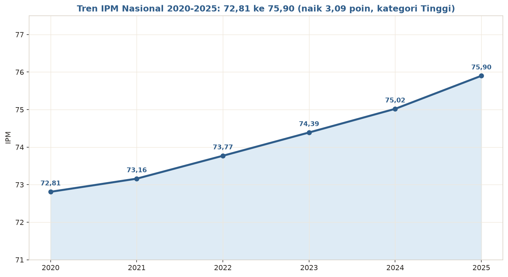
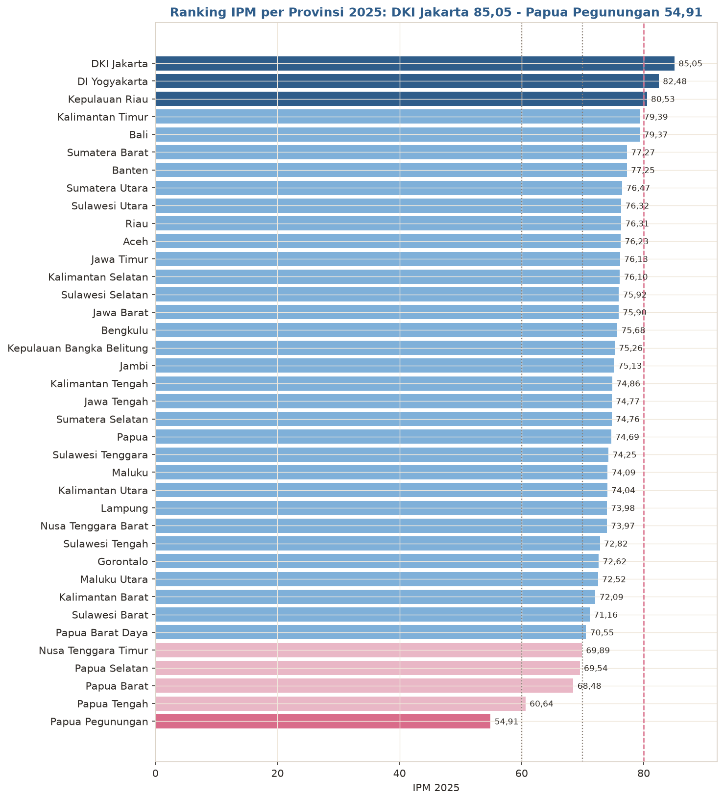
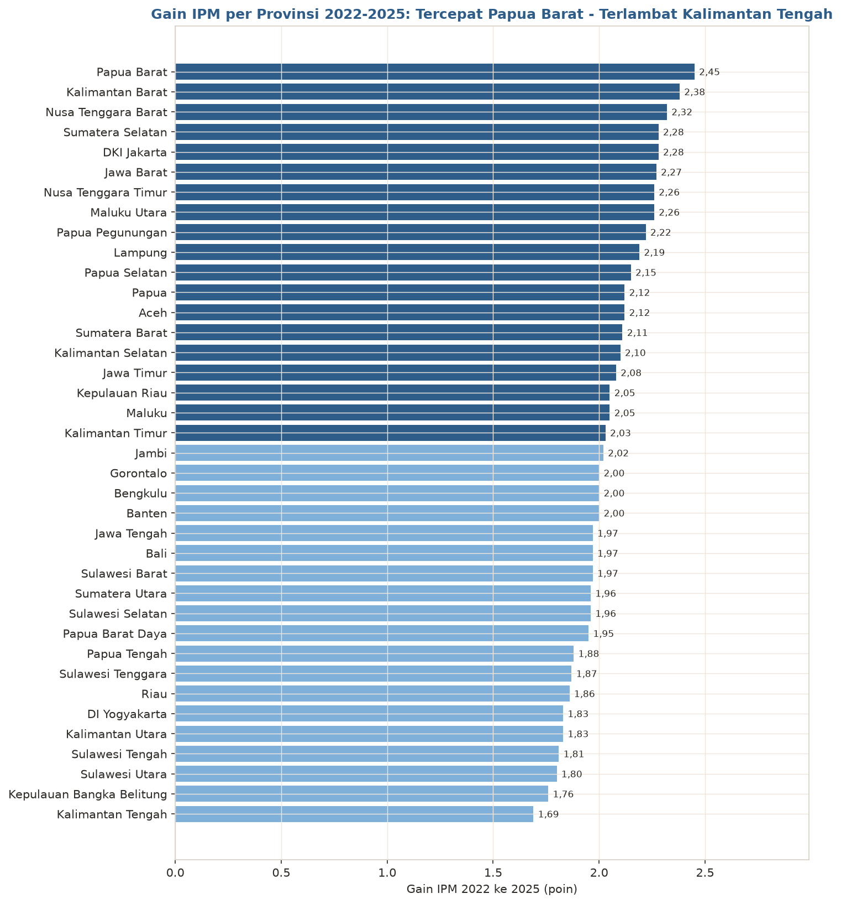
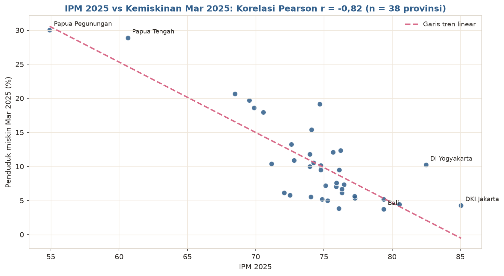
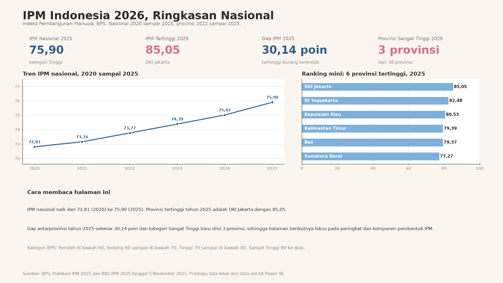

# IPM Indonesia 2026 — Indeks Pembangunan Manusia

Analisis portofolio atas **data resmi BPS**: Indeks Pembangunan Manusia
(IPM) Indonesia **2020-2025** dan IPM **38 provinsi 2022-2025**, lengkap
dengan empat komponen penyusunnya (Umur Harapan Hidup, Harapan Lama
Sekolah, Rata-rata Lama Sekolah, dan pengeluaran riil per kapita yang
disesuaikan). Ini proyek **data analyst** murni: statistik resmi, analisis
deskriptif dan diagnostik, dashboard Power BI, dan penceritaan insight.
Tidak ada machine learning di sini.

> **Headline 2025:** IPM Indonesia **75,90** (kategori **Tinggi**), naik
> **3,09 poin** dari 72,81 pada 2020. Provinsi tertinggi **DKI Jakarta
> 85,05**, terendah **Papua Pegunungan 54,91**: jurang **30,14 poin**.

## Temuan utama

1. **Naik konsisten enam tahun.** IPM nasional naik dari 72,81 (2020) ke
   75,90 (2025), rata-rata **+0,62 poin per tahun**, dan berstatus Tinggi
   di seluruh seri. Semua komponen ikut naik: UHH 73,37 ke 74,47 tahun
   (+1,10), RLS 8,48 ke 9,07 tahun (+0,59), HLS 12,98 ke 13,30 tahun
   (+0,32), pengeluaran riil Rp11.013 ribu ke Rp12.802 ribu per tahun
   (+16,2%).
2. **Jurang antarprovinsi masih lebar.** DKI Jakarta (85,05) berbanding
   Papua Pegunungan (54,91): selisih 30,14 poin atau 1,55 kali lipat.
   Hanya **3 provinsi** berstatus Sangat Tinggi (DKI Jakarta, DI
   Yogyakarta, Kepulauan Riau); sebarannya 30 Tinggi, 4 Sedang, dan
   1 Rendah.
3. **Yang tertinggal berlari lebih cepat, tetapi jurang belum menutup.**
   Pada rentang sebanding 2022-2025, rata-rata gain 10 provinsi terbawah
   (2,15 poin) melampaui 10 provinsi teratas (1,99 poin); gain tercepat
   Papua Barat (+2,45 poin), terlambat Kalimantan Tengah (+1,69 poin).
   Meski begitu, gap maksimum-minimum nyaris tidak bergerak: 30,08 poin
   (2022) menjadi 30,14 poin (2025).
4. **Ketertinggalan terbesar ada di pengeluaran dan stok pendidikan.**
   Rata-rata 10 provinsi IPM terendah berbanding nasional: pengeluaran
   Rp9.356 ribu vs Rp12.802 ribu per tahun, RLS 7,83 vs 9,07 tahun, UHH
   70,41 vs 74,47 tahun. Gap HLS-RLS (aliran vs stok sekolah) di kelompok
   bawah lebih lebar: 4,70 tahun berbanding 4,23 tahun nasional. Artinya
   anak-anak di provinsi tertinggal kini berharap sekolah lebih lama,
   tetapi stok pendidikan penduduk dewasanya tertinggal paling jauh.
5. **Rentang komponen ekstrem.** UHH berjarak 8,72 tahun antarprovinsi
   (DKI Jakarta 76,27 vs Papua Pegunungan 67,55). Pengeluaran riil
   tertinggi 3,53 kali yang terendah (Rp20.676 ribu vs Rp5.861 ribu).
6. **IPM dan kemiskinan bergerak berlawanan, kuat.** Korelasi IPM
   provinsi 2025 dengan persentase penduduk miskin Maret 2025 adalah
   **r = -0,82** (38 provinsi): DKI Jakarta IPM 85,05 dengan kemiskinan
   4,28%; Papua Pegunungan IPM 54,91 dengan kemiskinan 30,03%; Bali
   mencatat kemiskinan terendah 3,72% dengan IPM 79,37. Pasangan tahun
   dinyatakan eksplisit: IPM 2025 x kemiskinan Maret 2025 (data proyek
   kemiskinan-indonesia-2026, sama-sama bersumber dari BPS).

## Struktur repo

```
data/        CSV kompilasi BPS + SOURCES.md (ketertelusuran per angka)
charts/      12 grafik PNG berlabel Bahasa Indonesia
scripts/     compile_data.py, analysis.py, build_powerbi.py,
             build_ppt.py, build_module.py, build_pbip.py
sql/         queries.sql — kueri analitis atas CSV kompilasi
powerbi/     Kit Power BI: 5 CSV model bintang, measures_dax.md,
             dashboard_layout.md, build_guide.md, pratinjau dashboard
pbip/        Paket PBIP IPMIndonesia2026 (Report + SemanticModel + data CSV)
analysis.ipynb               Notebook reproduksi temuan dari CSV
findings.json                Seluruh angka temuan (dihitung analysis.py)
Portofolio-Analisis-IPM.pptx   Deck portofolio 10 slide
Modul-Analisis-IPM.pdf         Modul belajar (landscape, pemula)
```

## Data & metode

Seluruh angka **dikompilasi dari dua dokumen resmi BPS**: publikasi
tahunan *Indeks Pembangunan Manusia 2025* (Volume 20, 2026; Katalog
4102002), khususnya Lampiran 1 (IPM dan komponen per provinsi 2025) dan
Lampiran 3 (IPM per provinsi 2022-2025), serta **BRS IPM 2025
No. 104/11/Th. XXVIII (5 November 2025)** Tabel 1 untuk seri nasional
2020-2025. Ketertelusuran lengkap ada di `data/SOURCES.md`.

Catatan metodologi penting: IPM metode baru memakai UHH hasil Long Form
SP2020, sehingga seri konsisten dimulai 2020 (nasional) dan seri provinsi
publikasi terbaru mencakup 2022-2025. Sejak 2022 Papua tampil sebagai
6 provinsi hasil pemekaran, konsisten 38 provinsi di seluruh seri
provinsi; tidak ada pemetaan mundur ke tahun sebelum provinsi hasil
pemekaran ada. Kategori: Rendah (di bawah 60), Sedang (60 sampai di bawah
70), Tinggi (70 sampai di bawah 80), Sangat Tinggi (80 ke atas).

## Visualisasi Utama



*Tren IPM nasional, 2020 sampai 2025*



*Peringkat IPM 38 provinsi, 2025*



*Gain IPM per provinsi, 2022 ke 2025*



*IPM 2025 vs kemiskinan Maret 2025 per provinsi (r = -0,82)*

## Dashboard Power BI



*Pratinjau layout halaman 1 dashboard dari kit di folder `powerbi/`.*

Kit di folder `powerbi/` merakit file **`IPM-Indonesia-2026.pbix`**:

- Model bintang dengan grain terpisah: `fact_ipm_provinsi` (provinsi x
  tahun), `fact_ipm_nasional` (per tahun, termasuk komponen),
  `fact_komponen_provinsi` (komponen per provinsi 2025), `dim_provinsi`,
  `dim_tahun`.
- Measure DAX bernama polos di `measures_dax.md`, lengkap dengan tabel
  verifikasi (mis. IPM Nasional 2025 harus tampil **75,90**, IPM
  tertinggi 2025 **85,05**, provinsi Sangat Tinggi 2025 **3**).
- 4 halaman: Ringkasan Nasional · Peringkat Provinsi · Komponen ·
  Tren & Konvergensi. Pratinjau halaman 1:
  `powerbi/dashboard_preview_halaman1.png`.
- Paket **PBIP** di `pbip/IPMIndonesia2026/` memungkinkan membuka model
  dan report tanpa merakit dari nol: ekstrak, buka `.pbip`, arahkan
  parameter `FolderData` ke folder `data/` paket, Refresh, lalu Save As
  `.pbix`.

## Reproduksi

```bash
python scripts/compile_data.py   # data BPS -> CSV rapi + SOURCES.md
python scripts/analysis.py       # findings.json + 12 chart (dengan verifikasi)
python scripts/build_powerbi.py  # kit Power BI + measures + pratinjau
python scripts/build_ppt.py      # deck PPTX 10 slide
python scripts/build_module.py   # modul PDF
python scripts/build_pbip.py     # paket PBIP (tervalidasi)
```

## Tentang

Disusun oleh **BAGHIZ ASSHIDDIQIE ARASYA** — Data Analyst.
Bagian dari seri portofolio data Indonesia 2026 (kemiskinan, pariwisata,
pengangguran, harga pangan, harga cabai, gempa bumi, dan lainnya).
